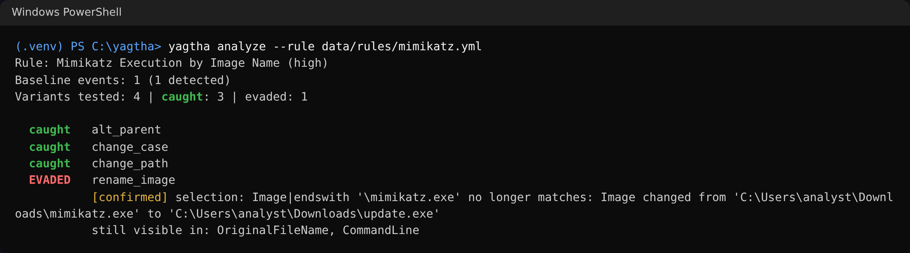
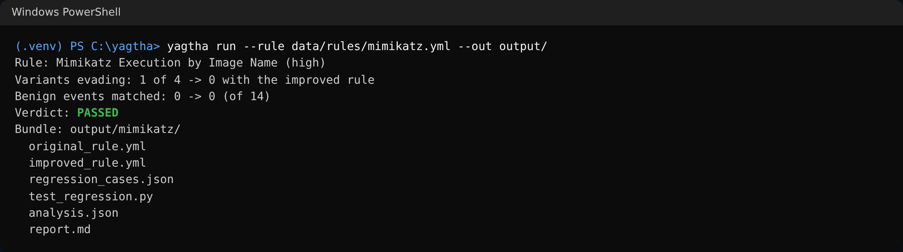

# YAGTHA (يقظة)

[](https://github.com/HoorFawaz/YAGTHA/actions/workflows/ci.yml)

**Test how robust a Sigma detection rule is against simple attacker changes, and fix it with proof.**

YAGTHA takes a Sigma rule for Windows process creation, replays the attack it
should catch with small behaviour-preserving changes (renamed file, other folder,
mixed case, reordered or encoded command line, different parent), explains every
miss, proposes an improved rule built only from evidence in the events, and
verifies it against both the attack variants and normal activity.

> Similar tools exist (Sigma tooling, rule-testing utilities). YAGTHA focuses on
> testing the robustness of detection rules against behavioral variations, and on
> helping analysts fix fragile rules with verifiable improvements.

## Before and after

The sample rule alerts when `Image` ends with `\mimikatz.exe`:

```yaml
detection:
  selection:
    Image|endswith: '\mimikatz.exe'
  condition: selection
```

**Before.** An attacker renames the file and the rule goes quiet, although
`OriginalFileName` and the command line still show mimikatz:



**After.** YAGTHA replaces only the defeated field (`Image`) with evidence that
survived the rename, and checks the result:

```yaml
detection:
  selection:
    Image|endswith: \mimikatz.exe
  yagtha_selection:
  - OriginalFileName: mimikatz.exe
  - CommandLine|contains|all:
    - privilege::debug
    - sekurlsa::logonpasswords
  condition: selection or yagtha_selection
```



The full bundle of this run (rules, report, regression tests) is in
[`examples/mimikatz_demo`](examples/mimikatz_demo). The screenshots are the real
terminal output of the commands, rendered as images.

## How it works

```
Sigma rule ──> loader ──> evaluator <── variants <── mutations <── baseline events
                              │
                          analyzer ──> why each variant evaded, what still shows the attack
                              │
                          improver ──> new rule from unchanged evidence only
                              │
                          verifier ──> variants again + benign events ──> regression cases
                              │
                    reporter + exporter ──> output/<rule>/ (report.md, rules, tests)
```

1. **Load** the rule safely (`yaml.safe_load`, size limits, supported subset only).
2. **Mutate** each baseline event into variants that keep the same behaviour.
3. **Analyze** every miss: which mutation, which selection and field, `confirmed`
   (putting the original value back makes the rule fire again) or `likely`, and
   which fields still carry the signal.
4. **Improve**: give the defeated field an alternative from the same event
   (`OriginalFileName`, the executable name, or distinctive arguments). Other
   conditions and filters stay as they are. With nothing safe to use, YAGTHA
   says **insufficient evidence** instead of guessing.
5. **Verify**: the improved rule must lose nothing the original caught and add
   no false positive on the benign corpus. What it gets right becomes regression
   cases.
6. **Export** a bundle with a Markdown report.

## Sample rules

`yagtha run --rule data/rules/` runs all of them in one command
([full output](docs/screenshots/all.png)).

| Rule | Weakness found | Result |
| --- | --- | --- |
| `mimikatz.yml` | Rename evades `Image\|endswith` | Fixed with `OriginalFileName` or the mimikatz arguments. PASSED |
| `comsvcs_minidump.yml` | Exact command-line prefix breaks when `rundll32.exe` is renamed | Fixed with the `MiniDump` argument. PASSED |
| `powershell_download_cradle.yml` | Rename, and `-EncodedCommand` hides `DownloadString` | Rename fixed with `OriginalFileName`. Encoding reported as insufficient evidence. PASSED |
| `whoami_discovery.yml` | Rename, and a filter on Explorer as parent | Rename fixed. The filter is reported for manual review. The benign corpus shows one admin `whoami /all` that both rules flag. PASSED |

All rules and events are synthetic, written for this project.

## Usage

Install (Python 3.11 or newer):

```bash
python -m venv .venv
source .venv/bin/activate      # Windows: .venv\Scripts\activate
pip install -e ".[dev]"
```

### `yagtha analyze`: find the evasions

```bash
yagtha analyze --rule data/rules/mimikatz.yml
```

```text
Rule: Mimikatz Execution by Image Name (high)
Baseline events: 1 (1 detected)
Variants tested: 4 | caught: 3 | evaded: 1

  caught   alt_parent
  caught   change_case
  caught   change_path
  EVADED   rename_image
           [confirmed] selection: Image|endswith '\mimikatz.exe' no longer matches: Image changed from 'C:\Users\analyst\Downloads\mimikatz.exe' to 'C:\Users\analyst\Downloads\update.exe'
           still visible in: OriginalFileName, CommandLine
```

### `yagtha improve`: propose and verify a fix

```bash
yagtha improve --rule data/rules/mimikatz.yml
```

```text
Rule: Mimikatz Execution by Image Name (high)
Original rule: 1 of 4 variants evade it

Proposed changes:
  - 'yagtha_selection': Image replaced by OriginalFileName 'mimikatz.exe' (survives rename_image)
  - 'yagtha_selection': Image replaced by CommandLine containing all of ['privilege::debug', 'sekurlsa::logonpasswords'] (survives rename_image)
  - condition 'selection' becomes 'selection or yagtha_selection'

Improved rule:

title: Mimikatz Execution by Image Name (improved by YAGTHA)
id: 90df4039-c4ab-5cbe-902b-1633e58a89a0
status: experimental
description: Derived by YAGTHA from rule 6a1f3c52-2b7e-4d8a-9c41-0e5b7f2d9a13. Each defeated field can
  also be matched by evidence that stayed the same in the variants that evaded the original rule.
author: Hoor Fawaz
logsource:
  category: process_creation
  product: windows
detection:
  selection:
    Image|endswith: \mimikatz.exe
  yagtha_selection:
  - OriginalFileName: mimikatz.exe
  - CommandLine|contains|all:
    - privilege::debug
    - sekurlsa::logonpasswords
  condition: selection or yagtha_selection
level: high
related:
- id: 6a1f3c52-2b7e-4d8a-9c41-0e5b7f2d9a13
  type: derived

Verification:
  variants evading: 1 -> 0
    fixed      event0/rename_image
  regressions: none
  benign events matched: 0 -> 0 (of 14)
  regression cases: 19 (5 match, 14 no_match)

Result: PASSED
```

### `yagtha run`: full pipeline and export

```bash
yagtha run --rule data/rules/mimikatz.yml --out output/
```

```text
Rule: Mimikatz Execution by Image Name (high)
Variants evading: 1 of 4 -> 0 with the improved rule
Benign events matched: 0 -> 0 (of 14)
Verdict: PASSED
Bundle: output/mimikatz/
  original_rule.yml
  improved_rule.yml
  regression_cases.json
  test_regression.py
  analysis.json
  report.md
```

The verdict is `ROBUST`, `PASSED`, `FAILED`, `INSUFFICIENT EVIDENCE` or
`NOT DETECTED`. `run` exits with 1 on `FAILED`, so it can gate a CI job. Run
`pytest` inside a bundle folder to re-check the improved rule. Bundles are only
written inside `output/`.

Common options: `--events my_events.json`, `--benign my_benign.json`,
`--mutations rename_image,change_path`, `--json` (analyze, improve), and
`yagtha list-mutations`.

## Mutations

Each mutation keeps the attacker's behaviour and changes one detail they control.
Every mutation is a pure, deterministic function: the original event is never modified.

| Mutation | What changes |
| --- | --- |
| `rename_image` | Executable renamed (`OriginalFileName` still shows the real tool) |
| `change_path` | Same executable run from another folder |
| `change_case` | Mixed upper/lower case in file name and command line |
| `reorder_args` | Leading switches in a different order |
| `encode_cmdline` | PowerShell plain command vs `-EncodedCommand` |
| `add_noise_args` | A harmless extra switch (`-NoLogo`, `/d`) |
| `alt_parent` | A different parent process |

## Tests and quality

```bash
pytest
ruff check . && ruff format --check .
mypy
bandit -q -r src
```

CI runs all of these plus `pip-audit` on Python 3.11, 3.12 and 3.13, and runs
`yagtha run` on every sample rule.

## Docs

- [Architecture](docs/architecture.md)
- [Supported Sigma subset](docs/supported-sigma-subset.md)
- [Threat model](docs/threat-model.md)
- [Mimikatz demo](examples/mimikatz_demo)

## Security

Rules and logs are treated as untrusted data and are never executed. Reports
escape every value, and exports cannot leave `output/`. All sample data is
synthetic. See the [threat model](docs/threat-model.md).

## Limitations

- Windows `process_creation` rules and the documented Sigma subset only
  (no aggregations, keywords or `timeframe`).
- Mutations are a fixed set of common changes, not every possible evasion.
- The improver only uses what is in the events. Encoded command lines and
  filters need a human, and YAGTHA says so.
- The benign corpus is small and synthetic. Test against your own normal
  activity (`--benign`) before deploying an improved rule.

## License

MIT
