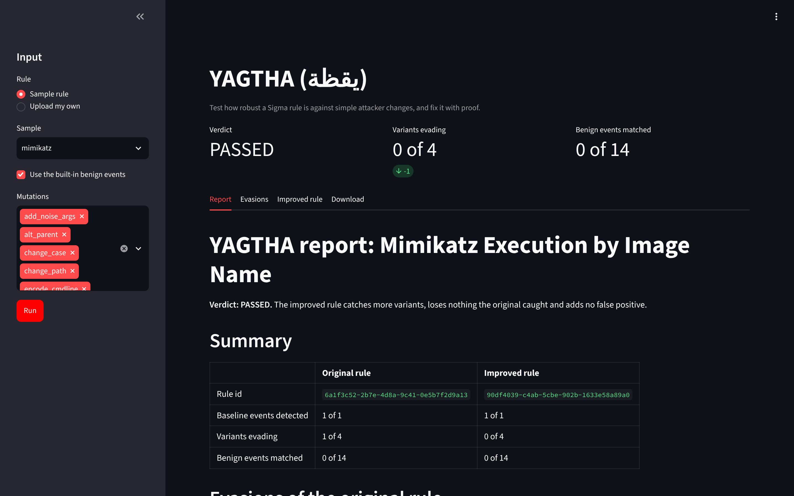
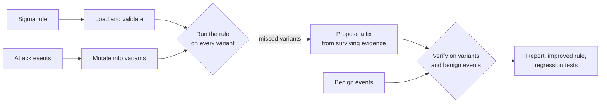
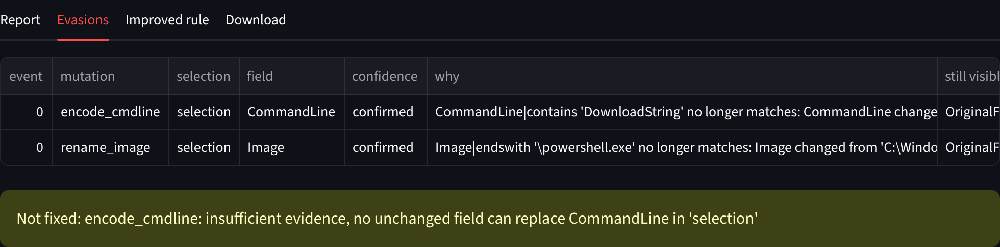
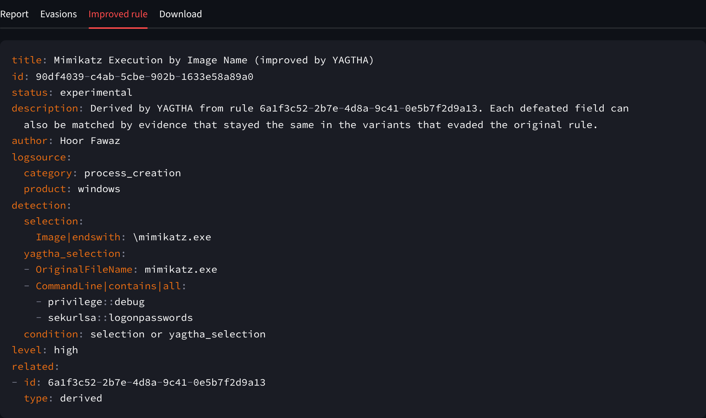

<div align="center">

# YAGTHA · يقظة

**Test how robust a Sigma detection rule is against simple attacker changes, and fix it with proof**

Python · Sigma · PyYAML · Streamlit · pytest

[](https://github.com/HoorFawaz/YAGTHA/actions/workflows/ci.yml)

</div>



A SOC team has a rule that alerts when `mimikatz.exe` runs. An attacker copies the same file to
`update.exe` and runs it again. Nothing about the attack changed, but the rule stays silent, and
nobody notices until much later.

YAGTHA finds that kind of gap before an attacker does. It takes a Sigma rule and the events it is
supposed to catch, replays the attack with small changes that keep the same behaviour (a renamed
file, another folder, mixed case, reordered or encoded arguments, a different parent process), and
explains every variant the rule misses. It then proposes an improved rule built only from evidence
that is really in the events, and proves that the new rule catches more, loses nothing, and does
not fire on normal activity.

> **Status:** complete and tested on Python 3.11, 3.12 and 3.13. Everything runs locally from the
> command line or a small web UI. All sample rules and events are synthetic, written for this
> project. How the parts fit: [docs/architecture.md](docs/architecture.md).

**Contents:** [The problem](#the-problem) · [How it works](#how-it-works) ·
[Key features](#key-features) · [Example results](#example-results) · [Web UI](#web-ui) ·
[Try it](#try-it) · [Full guide](#full-guide) · [Security](#security) ·
[Limitations](#limitations) · [License](#license)

## The problem

Detection rules are often written against one sample of an attack. They match the exact file name,
path or command line seen in that sample. Those are details the attacker controls, so a rule can
look fine in testing and still be bypassed by a rename.

Checking this by hand means building every variation, running the rule on each one, working out
why it missed, editing the rule, and then making sure the edit did not break something else or
start alerting on normal activity. YAGTHA does those steps automatically and writes down the
evidence for each one, so an analyst can review a concrete proposal instead of starting from
nothing.

## How it works



1. **Load** the rule safely (`yaml.safe_load`, size limits, the supported Sigma subset only).
2. **Mutate** each attack event into variants that keep the same behaviour.
3. **Analyze** every miss: which mutation, which selection and which field stopped matching,
   whether it is `confirmed` (putting the original value back makes the rule fire again) or
   `likely`, and which fields still show the attack.
4. **Improve** the rule: give only the defeated field an alternative taken from the same event
   (`OriginalFileName`, the executable name, or distinctive command-line arguments). Every other
   condition and every filter stays as it was. With nothing safe to use, YAGTHA reports
   **insufficient evidence** instead of guessing.
5. **Verify** the improved rule: it must lose nothing the original caught and add no false
   positive on the benign events. What it gets right becomes regression test cases.
6. **Export** a bundle with a Markdown report, both rules and a ready-to-run regression test.

### Before and after

The sample rule only looks at the executable name:

```yaml
detection:
  selection:
    Image|endswith: '\mimikatz.exe'
  condition: selection
```

Renaming the file defeats it, although `OriginalFileName` and the command line still show
mimikatz. YAGTHA keeps the original selection and adds an alternative for the defeated field only:

```yaml
detection:
  selection:
    Image|endswith: \mimikatz.exe
  yagtha_selection:
  - OriginalFileName: mimikatz.exe
  - CommandLine|contains|all:
    - privilege::debug
    - sekurlsa::logonpasswords
  condition: selection or yagtha_selection
```

The complete output of this run (both rules, report and regression tests) is committed in
[examples/mimikatz_demo](examples/mimikatz_demo).

## Key features

- **Seven deterministic mutations** for Windows process creation events: rename, other folder,
  mixed case, reordered switches, encoded PowerShell, extra harmless switch, different parent.
- **Explained misses:** for each evasion, the selection and field that stopped matching, a
  confidence level, and the fields that still carry the signal.
- **Evidence-only fixes:** replacement values are copied from the events, with Sigma wildcards
  escaped. Nothing is invented, and filters are never changed automatically.
- **Verification against normal activity:** both rules run on the same variants and on a benign
  corpus. A fix that loses a detection or adds a false positive is marked `FAILED`.
- **Regression tests:** each bundle includes `regression_cases.json` and a static
  `test_regression.py` that re-checks the improved rule with `pytest`.
- **Clear verdicts:** `ROBUST`, `PASSED`, `FAILED`, `INSUFFICIENT EVIDENCE` or `NOT DETECTED`.
  `yagtha run` exits with 1 on `FAILED`, so it can gate a CI job.
- **Command line and web UI** built on the same pipeline, so both give the same result.
- **Optional AI summary** (`--explain`): a short plain-language explanation of a finished run,
  labelled as AI-generated. It never changes a rule, a verdict or a test.

## Example results

Real output of `yagtha run --rule data/rules/` on the four sample rules, with all seven mutations
and the 14 built-in benign events. A mutation that does not apply to an event (for example
`encode_cmdline` on a process that is not PowerShell) produces no variant, so the number of
variants differs per rule.

| Rule | Weakness found | Variants evading (before → after) | Benign matched (before → after) | Verdict |
| --- | --- | --- | --- | --- |
| [`mimikatz.yml`](data/rules/mimikatz.yml) | A rename defeats `Image\|endswith` | 1 of 4 → 0 | 0 → 0 | PASSED |
| [`comsvcs_minidump.yml`](data/rules/comsvcs_minidump.yml) | The command-line prefix breaks when `rundll32.exe` is renamed | 1 of 4 → 0 | 0 → 0 | PASSED |
| [`powershell_download_cradle.yml`](data/rules/powershell_download_cradle.yml) | A rename, and `-EncodedCommand` hides `DownloadString` | 2 of 7 → 1 | 0 → 0 | PASSED |
| [`whoami_discovery.yml`](data/rules/whoami_discovery.yml) | A rename, and a filter on Explorer as the parent | 2 of 4 → 1 | 1 → 1 | PASSED |

```text
Rules: 4 | 4 PASSED
```

What this shows:

- **Renames** were the most common weakness. In every rule YAGTHA fixed them with
  `OriginalFileName`, the executable name, or distinctive arguments that survived the rename.
- **The encoded PowerShell variant** stays unfixed on purpose: after base64 encoding, no field
  still contains `DownloadString`, so there is no evidence to build a safe fix from. YAGTHA
  reports it as insufficient evidence.
- **The filter evasion** in `whoami_discovery.yml` is reported for manual review, because changing
  a filter is a judgement call for an analyst.
- **The one benign match** in `whoami_discovery.yml` is a synthetic helpdesk user running
  `whoami /all` from `cmd.exe`. Both the original and the improved rule flag it, so the fix adds
  no new false positive.

These results describe four small synthetic examples. They show how the tool behaves; they are not
a measurement of detection quality on real data.

## Web UI

The same pipeline in the browser. Pick a sample rule or upload your own rule and events, choose
the benign events and mutations, and press **Run**. Everything runs in memory: nothing is written
to disk, and the bundle is offered as a zip download.

### Evasions, with the reason for each miss

For the PowerShell download cradle, two variants evade the original rule. The rename is fixed; the
encoded command is reported as not fixed because no evidence survived it:



### The improved rule

The proposed rule, ready to copy. It gets a new deterministic id and a `related: derived` link to
the original rule:



The screenshots were taken from the running Streamlit app (dark theme) with the sample data in
this repository.

## Try it

Needs Python 3.11 or newer.

```bash
git clone https://github.com/HoorFawaz/YAGTHA.git
cd YAGTHA
python -m venv .venv
source .venv/bin/activate      # Windows: .venv\Scripts\activate
pip install -e ".[dev]"
yagtha run --rule data/rules/
```

The bundles are written to `output/<rule name>/`. To open the web UI instead:

```bash
pip install -e ".[ui]"
streamlit run app/streamlit_app.py
```

---

## Full guide

### Installation

| Command | Installs |
| --- | --- |
| `pip install -e .` | The core tool and the `yagtha` command (PyYAML, regex) |
| `pip install -e ".[dev]"` | Plus pytest, ruff, mypy, bandit and pip-audit |
| `pip install -e ".[ui]"` | Plus Streamlit for the web UI |
| `pip install -e ".[llm]"` | Plus the Anthropic SDK for the optional AI summary |

Extras can be combined, for example `pip install -e ".[dev,ui,llm]"`.

### `yagtha analyze`: find the evasions

```bash
yagtha analyze --rule data/rules/mimikatz.yml
```

```text
Rule: Mimikatz Execution by Image Name (high)
Baseline events: 1 (1 detected)
Variants tested: 4 | caught: 3 | evaded: 1

  caught   alt_parent
  caught   change_case
  caught   change_path
  EVADED   rename_image
           [confirmed] selection: Image|endswith '\mimikatz.exe' no longer matches: Image changed from 'C:\Users\analyst\Downloads\mimikatz.exe' to 'C:\Users\analyst\Downloads\update.exe'
           still visible in: OriginalFileName, CommandLine
```

### `yagtha improve`: propose and verify a fix

```bash
yagtha improve --rule data/rules/mimikatz.yml
```

It prints the proposed changes, the full improved rule and the verification. The end of the
output:

```text
Verification:
  variants evading: 1 -> 0
    fixed      event0/rename_image
  regressions: none
  benign events matched: 0 -> 0 (of 14)
  regression cases: 19 (5 match, 14 no_match)

Result: PASSED
```

### `yagtha run`: full pipeline and export

```bash
yagtha run --rule data/rules/mimikatz.yml --out output/
```

```text
Rule: Mimikatz Execution by Image Name (high)
Variants evading: 1 of 4 -> 0 with the improved rule
Benign events matched: 0 -> 0 (of 14)
Verdict: PASSED
Bundle: output/mimikatz/
  original_rule.yml
  improved_rule.yml
  regression_cases.json
  test_regression.py
  analysis.json
  report.md
```

`--rule` can also be a folder; every `*.yml` rule in it is run. To re-check an improved rule later,
run `pytest` inside its bundle folder. Bundles are only ever written inside `output/`.

Exit codes: `0` success, `1` an improved rule failed verification, `2` invalid input or another
error.

### Options

| Option | Commands | Meaning |
| --- | --- | --- |
| `--rule` | `analyze`, `improve`, `run` | Sigma rule (YAML), or a folder of rules for `run` |
| `--events` | `analyze`, `improve`, `run` | Attack events (JSON). Default: `data/malicious_events/<rule name>.json` |
| `--benign` | `improve`, `run` | Normal activity events (JSON). Default: `data/benign_events/benign.json` |
| `--mutations` | `analyze`, `improve`, `run` | Comma-separated mutation names, for example `rename_image,change_path` (default: all) |
| `--json` | `analyze`, `improve` | Print the result as JSON |
| `--out` | `run` | Output folder, must be inside `./output` (default: `output/`) |
| `--explain` | `run` | Add the optional AI summary to the report |

`yagtha list-mutations` lists the mutations, and `yagtha --help` shows every command.

### Mutations

Each mutation keeps the attacker's behaviour and changes one detail they control. Every mutation
is a pure, deterministic function: the original event is never modified.

| Mutation | What changes |
| --- | --- |
| `rename_image` | The executable is renamed (`OriginalFileName` still shows the real tool) |
| `change_path` | The same executable runs from another folder |
| `change_case` | Mixed upper and lower case in the file name and command line |
| `reorder_args` | Leading switches in the reverse order |
| `encode_cmdline` | PowerShell switches between a plain and a base64-encoded command |
| `add_noise_args` | A harmless extra switch (such as `-NoLogo` or `/d`) |
| `alt_parent` | The same process starts from a different parent |

### Input files

A rule is a Sigma YAML file for Windows `process_creation`; see the
[supported Sigma subset](docs/supported-sigma-subset.md). Events are a JSON list of flat objects
with Sysmon-like field names, for example:

```json
[
  {
    "Image": "C:\\Users\\analyst\\Downloads\\mimikatz.exe",
    "OriginalFileName": "mimikatz.exe",
    "CommandLine": "mimikatz.exe \"privilege::debug\" \"sekurlsa::logonpasswords\" exit",
    "ParentImage": "C:\\Windows\\System32\\cmd.exe",
    "User": "LAB\\analyst"
  }
]
```

The sample data is described in [data/README.md](data/README.md).

### Web UI

```bash
pip install -e ".[ui]"
streamlit run app/streamlit_app.py
```

Streamlit prints a local address (by default http://localhost:8501). Uploaded files are checked
with the same limits as the command line (256 KB per rule, 5 MB per events file). The upload
widget shows Streamlit's generic size note, but YAGTHA refuses anything over these limits.

### Optional AI summary

```bash
pip install -e ".[llm]"
export ANTHROPIC_API_KEY=...          # Windows PowerShell: $env:ANTHROPIC_API_KEY = "..."
yagtha run --rule data/rules/mimikatz.yml --explain
```

YAGTHA sends only the computed results of the run (counts, findings with their explanations,
proposed changes, verdict) to the Anthropic API and adds a short summary to `report.md` under
"In plain words (AI-generated, may contain mistakes)". The key is read only from the environment.
The model can be changed with the `YAGTHA_LLM_MODEL` environment variable. Without the package or
the key, `--explain` prints a warning and the run finishes normally without the summary.

### The bundle

| File | Contents |
| --- | --- |
| `original_rule.yml` | The rule as given |
| `improved_rule.yml` | The proposed rule (only when a fix was found) |
| `regression_cases.json` | Variants that must match and benign events that must not (only with a fix) |
| `test_regression.py` | Static pytest file that checks those cases (only with a fix) |
| `analysis.json` | Machine-readable findings, changes and verification |
| `report.md` | The full report: summary, evasions, changes, verification, every variant |

### Tests and quality checks

```bash
pytest
ruff check .
ruff format --check .
mypy
bandit -q -r src
pip-audit --skip-editable
```

The test suite covers the loader, evaluator, mutations, analyzer, improver, verifier, reporter,
exporter, CLI, web UI and the AI summary (with a fake provider, so no test calls a real model).
`tests/test_samples.py` regenerates [examples/mimikatz_demo](examples/mimikatz_demo) and fails if
it differs, so the demo always matches the code. The web UI and Anthropic tests are skipped when
those optional packages are not installed.

[GitHub Actions](.github/workflows/ci.yml) runs all of these checks on Python 3.11, 3.12 and 3.13
for every push to `main` and every pull request, and runs `yagtha run` on every sample rule.

### Project layout

```text
app/streamlit_app.py     web UI
src/yagtha/              the package (loader, evaluator, mutations, analyzer, improver, ...)
src/yagtha/llm/          optional AI summary
data/rules/              four sample Sigma rules
data/malicious_events/   attack events for each sample rule
data/benign_events/      14 benign events used to check for false positives
examples/mimikatz_demo/  a complete committed bundle
docs/                    architecture, supported Sigma subset, threat model, screenshots
tests/                   pytest suite
```

### Documentation

- [Architecture](docs/architecture.md)
- [Supported Sigma subset](docs/supported-sigma-subset.md)
- [Threat model](docs/threat-model.md)
- [Mimikatz demo bundle](examples/mimikatz_demo)

## Security

Rules and events are written by other people, so YAGTHA treats them as untrusted data and never
executes anything in them.

- Only `yaml.safe_load` is used; there is no `eval`, `exec`, `pickle` or `shell=True`.
- Files, rules, selections, values, conditions and events have size limits.
- Wildcards are matched without regex. Regex values are length-limited, nested quantifiers are
  rejected, and each search has a time limit (ReDoS protection).
- Unsupported Sigma features raise a clear error instead of being silently ignored.
- Every value from a rule or event is escaped before it goes into the Markdown report.
- Bundles are written only inside `./output`, with fixed file names, a sanitised folder name and
  no symbolic links. The generated test file is static.
- No secrets are stored in the repository; the optional API key comes from an environment variable.
- YAGTHA never runs malware or a sandbox. All sample data is synthetic.

Details: [docs/threat-model.md](docs/threat-model.md).

## Limitations

- Only Windows `process_creation` rules and the documented Sigma subset are supported (no
  aggregations, keyword lists or `timeframe`).
- The mutations are a fixed set of common changes, not every possible evasion.
- The improver only uses what is in the events. Encoded command lines and filters need a human,
  and YAGTHA says so.
- The benign corpus is small and synthetic. Test an improved rule against your own normal activity
  (`--benign`) before deploying it.
- The sample results above come from four synthetic rules; they are examples, not a benchmark.

## License

[MIT](LICENSE) © 2026 Hoor Fawaz
